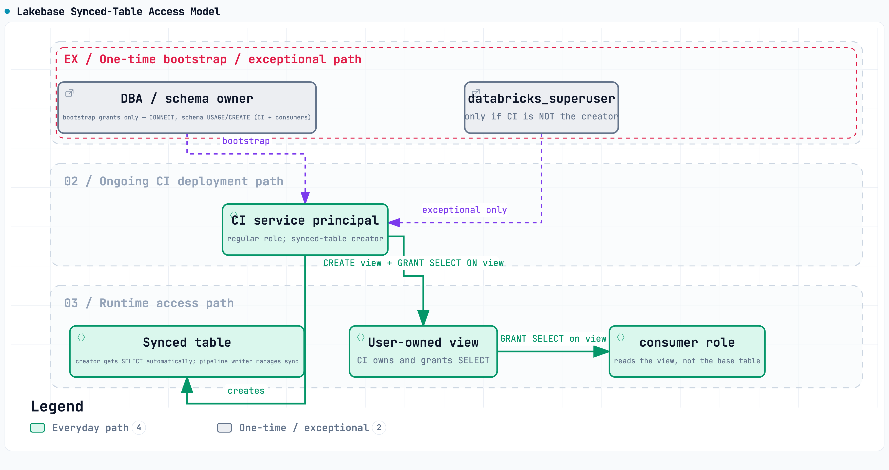
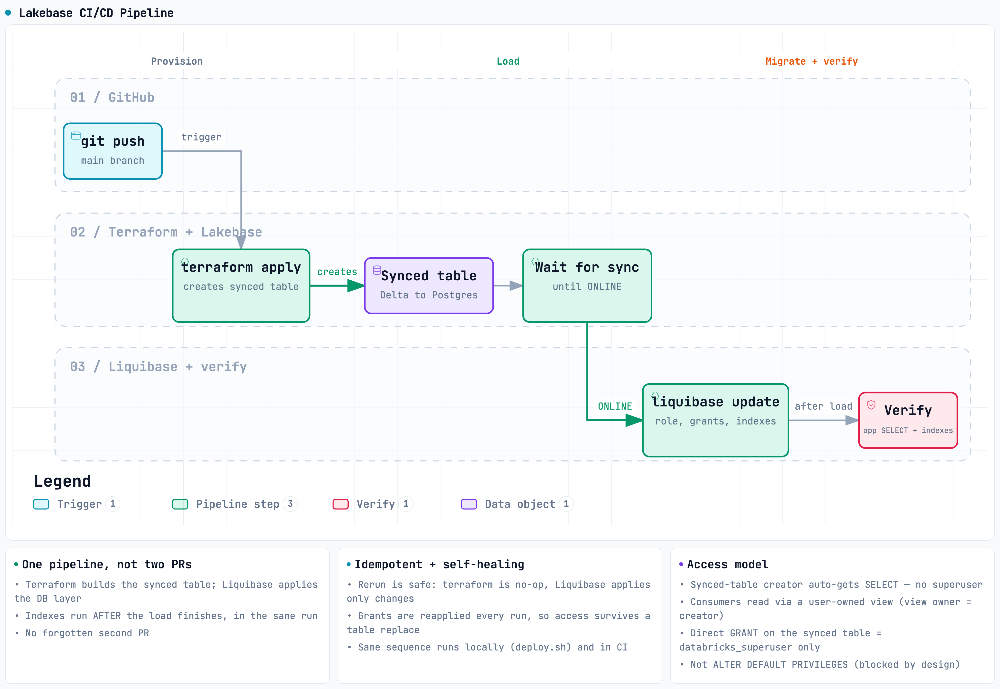

# Databricks Lakebase CI/CD Reference

This repo is a working reference for a CI/CD pipeline on Databricks Lakebase. Lakebase is a
Postgres database for OLTP (online transaction processing) that syncs tables from Delta. The
pipeline creates a synced table, waits for its first load to finish, then applies a database role,
grants, indexes, and a read-only consumer view. It is for data and platform engineers who want a
working blueprint to copy and adapt.

There are two paths in this repo. Declarative Automation Bundles (DABs, formerly Databricks Asset
Bundles) is the recommended path if you
are all-in on Databricks. Terraform plus Liquibase is the portable path if you are multi-cloud or
already standardized on Terraform. Both produce the same database objects from the same config file.

> This is sample code, not a turnkey deployment. Point the variables at your own workspace, review
> each step, and run it.

---

## Recommended path: Declarative Automation Bundles (DABs)

Declarative Automation Bundles (DABs; formerly Databricks Asset Bundles,
[docs](https://docs.databricks.com/aws/en/dev-tools/bundles/)) support Lakebase resources directly
via the `postgres_synced_tables` (`postgres_synced_table`) bundle resource (**Beta** —
[bundle resources](https://docs.databricks.com/aws/en/dev-tools/bundles/resources), checked
2026-10-22). That keeps the whole pipeline
on one platform, with fewer outside tools. This is the path a Databricks-first team should start
from.

The flow: edit one config file, generate the bundle resources, then deploy and run. Migrations run
as a Databricks Workflow job. There is no Terraform and no Liquibase on this path.

```bash
# 1. list the tables you want to manage (the single source of truth):
$EDITOR config/tables.json

# 2. generate the bundle resources from that config:
python -m dabs.generate_resources          # writes dabs/resources/*.yml

# 3. from the bundle root, check the bundle (safe to run on a pull request):
cd dabs
databricks bundle validate --target dev \
  --var lakebase_branch=projects/<project-id>/branches/main \
  --var lakebase_database=databricks_postgres

# 4. on merge, deploy the bundle and run the migration job:
databricks bundle deploy --target dev \
  --var lakebase_branch=... --var lakebase_database=...
databricks bundle run lakebase_migration \
  --var lakebase_branch=... --var lakebase_database=...
```

The migration job takes no database-instance name. It stays on the projects (Autoscaling) API: it
resolves the target branch's READ_WRITE compute endpoint and mints a runtime OAuth credential from
that endpoint (a workspace-scoped token, no stored secret). The branch alone — not an instance
name — selects where the migration lands, so there is nothing to point at the production branch by
mistake. `var.lakebase_database` (default `databricks_postgres`) is threaded into the generated
synced-table resources and into every job task (`verify_identity_policy`, `migrate`, and `verify`).

`config/tables.json` is the single source of truth. DABs YAML cannot loop a list into many
resources, so `python -m dabs.generate_resources` reads that file and writes one synced table per
entry into `dabs/resources/*.yml`. The app role is not written as a `postgres_roles` resource — an
admin creates each `NOLOGIN` app role once (`CREATE ROLE <app_role> NOLOGIN`) before the first
deploy (on both `dev` and `prod` targets), and the migration job checks `pg_roles` (`role_guard_sql`)
and fails loudly with `app role <name> does not exist; an admin must create it` if the role is
missing. That keeps `bundle destroy` from dropping the role out from under grants that consumers
still hold, and keeps the deploy service principal free of `CREATEROLE` (see "Run the prod target as
a deploy service principal"). The generated files are diffable, so re-running codegen after a config
edit is a clean diff. Do not hand-edit them.

### How migrations run

The migration is a bundle-managed Databricks Workflow job. It runs on serverless Python compute. A
small renderer (`dabs/render_ddl.py`) turns `config/tables.json` into idempotent SQL. The renderer
is stdlib-only, so there is no Java, no Liquibase, and no migration framework to install in the job.

At run time the job reads `config/tables.json`, waits for every synced table to reach `ONLINE`,
then applies the database objects in order: the read-only role check, explicit grants, indexes, and the
consumer view. Every statement is idempotent (a `pg_roles` existence check, `GRANT`,
`CREATE INDEX IF NOT EXISTS`, `DROP VIEW IF EXISTS` + `CREATE OR REPLACE VIEW` in one transaction), and there is no migration version table. If
a synced table is replaced or its columns change, the job reapplies the objects on the next run. This is reconciliation,
not one-time setup — re-running is a clean no-op, never a version-bookkeeping conflict.

After migrate, a `verify` task checks the result and fails the run, so `bundle run` exits non-zero,
when any check fails. Per table it checks that the app role exists and can read its consumer view,
that the consumer view does not have `security_invoker` enabled in `pg_class.reloptions`, that a
real read through the view succeeds (as the deploy identity, which owns the view and holds `SELECT`
on the base synced table), that each index exists, and that the app role is denied on
the base synced table by every route: a table grant, a column grant, a grant to `PUBLIC`, or a grant
on a role it is a member of (including `NOINHERIT` memberships it could `SET ROLE` into). Migrate never revokes anything, so a direct grant an admin added
stays until someone removes it, and verify fails until then. On serverless, a failed task can run a
second time before the run fails, because serverless auto-optimization retries failed tasks by
default ([docs](https://docs.databricks.com/aws/en/jobs/run-serverless-jobs)). The checks only read,
so the second run is safe; expect two sets of FAIL lines and about 20 more seconds. The migrate log
prints one `wait:` line per table per poll, so the wait shows in the run output.

In the `prod` target a third task, `verify_identity_policy`, runs **before** migrate. It fails unless
the job runs as the deploy service principal (`${var.run_as_sp}`) and that identity cannot read or
write every table or create roles: no membership in `databricks_superuser`, `pg_read_all_data` or
`pg_write_all_data`, directly or through another role, and no `CREATEROLE` or `SUPERUSER` on itself
or on a role it belongs to. So the job changes nothing in Postgres under an identity that fails the
policy. The task is defined only in the `prod` target, with no run-time switch: turning it off is a
change to `dabs/databricks.yml`, through review. It reads only Postgres rights, so it protects the
job's steps, not `bundle deploy`, which runs as whatever identity CI signs in as. This is a policy
choice, not a platform rule: a team that gives its deploy identity `databricks_superuser` deletes the
task and migrate's `depends_on` in the `prod` target. The checks are in `dabs/checks.py`.

### Run the prod target as a deploy service principal

The commands above use `--target dev`, which runs as you. The `prod` target runs the job as a
fixed deploy service principal (`${var.run_as_sp}`), and its first task, the identity policy guard,
fails unless that identity is outside `databricks_superuser` and has no `CREATEROLE`. So an admin
sets the identity up once, and the service principal runs every deploy after that.

| Who | Does what | How often |
|---|---|---|
| Admin (a workspace admin or the project owner) | Unity Catalog grants, project permission, the service principal's Postgres login role, each app role | Once |
| Deploy service principal | `bundle deploy` and `bundle run` with `--target prod` | Every deploy |

```bash
export ADMIN_PROFILE=<admin-cli-profile>
export SP_PROFILE=<cli-profile-that-signs-in-as-the-deploy-sp>   # OAuth M2M locally; in CI, OIDC (RUNBOOK.md, "CI auth")
export SP=<deploy-sp-application-id>
export PROJECT=<lakebase-project-id>
export BRANCH=projects/$PROJECT/branches/production
export WAREHOUSE_ID=<sql-warehouse-id>

# 0. demo only: create the source Delta tables (in real use, your data pipeline makes them)
PROFILE=$ADMIN_PROFILE ./scripts/seed_source.sh
```

**1. Admin, once.** Unity Catalog grants, in a SQL warehouse or a notebook. The example config keeps
the source and the synced tables in one schema; if yours differ, give `SELECT` on the source schema
and `CREATE TABLE` on the synced one.

```sql
GRANT USE CATALOG ON CATALOG my_catalog TO `<sp-application-id>`;
GRANT USE SCHEMA, SELECT, CREATE TABLE ON SCHEMA my_catalog.cicd_proj TO `<sp-application-id>`;
```

Project permission. `CAN_USE` is enough for the deploy service principal: paired with the Unity
Catalog grants above, `CAN_USE` allows minting a database token and creating synced tables with
`bundle deploy` (or Terraform). `CAN_USE` does **not** allow creating, deleting, or unprotecting
Lakebase branches — those require `CAN_MANAGE` on the project (verified live 2026-10-09).

```bash
databricks api patch /api/2.0/permissions/database-projects/$PROJECT -p $ADMIN_PROFILE \
  --json "{\"access_control_list\":[{\"service_principal_name\":\"$SP\",\"permission_level\":\"CAN_USE\"}]}"
```

Postgres, on the target branch, connected as the admin (`scripts/resolve_endpoint.sh` resolves the
host and mints the token). One `CREATE ROLE` per `app_role` in `config/tables.json`:

```sql
CREATE EXTENSION IF NOT EXISTS databricks_auth;
SELECT databricks_create_role('<sp-application-id>', 'service_principal');
CREATE ROLE members_app_ro NOLOGIN;
CREATE ROLE providers_app_ro NOLOGIN;
```

**2. Deploy service principal, every deploy.** The same principal runs both commands: the identity
that creates a synced table is the one that can build the view on it (on the Terraform path,
`deploy.sh` accepts any `PGUSER` env var; if `PGUSER` is not the identity that created the synced
table and schema, the deploy fails closed at `CREATE VIEW` / `GRANT` with `permission denied for
schema` or `permission denied for table`).

```bash
python -m dabs.generate_resources
cd dabs
databricks bundle deploy --target prod -p $SP_PROFILE \
  --var run_as_sp=$SP --var lakebase_branch=$BRANCH
databricks bundle run lakebase_migration --target prod -p $SP_PROFILE \
  --var run_as_sp=$SP --var lakebase_branch=$BRANCH
```

The `prod` target deploys to `/Workspace/.bundle/lakebase-cicd-dabs/prod`. The service principal
needs write access to that folder, or set `workspace.root_path` in `dabs/databricks.yml` to a folder
it owns. The live test used a folder in the service principal's home.

A good run prints the guard, then migrate, then verify (live output, one table, renamed to the
example names and updated with the 9th `security_invoker` check):

```text
== identity policy guard: 6 check(s) on projects/<project>/branches/<branch> ==
  PASS the job runs as the expected deploy identity <deploy-sp>
  PASS current_user is not a member of databricks_superuser (directly or through another role)
  PASS current_user is not a member of pg_read_all_data (directly or through another role)
  PASS current_user is not a member of pg_write_all_data (directly or through another role)
  PASS neither current_user nor a role it belongs to has CREATEROLE
  PASS neither current_user nor a role it belongs to has SUPERUSER
  IDENTITY POLICY GUARD OK
migration applied: all synced tables ONLINE, grants/indexes/view reconciled.
== verify: 9 check(s) on projects/<project>/branches/<branch> ==
  PASS role members_app_ro exists
  PASS consumer view cicd_proj.members_v exists
  PASS consumer view cicd_proj.members_v does not have security_invoker enabled
  PASS role members_app_ro can SELECT cicd_proj.members_v
  PASS role members_app_ro has USAGE on schema cicd_proj
  PASS a real read through cicd_proj.members_v succeeds
  PASS role members_app_ro is denied on synced table cicd_proj.members
  PASS index idx_members_member_id exists
  PASS index idx_members_plan_code exists
  VERIFY OK
```

When it fails:

- **The guard prints `FAIL current_user is not a member of databricks_superuser`.** The service
  principal is in `databricks_superuser`. Remove it with the roles API:
  `databricks postgres update-role <role> spec.membership_roles --json '{"spec":{"membership_roles":[]}}'`.
  The job changed nothing in Postgres.
- **`permission denied for schema`.** A different identity is running the job than the one that
  created the tables. Keep one deploy service principal for the life of the tables ("Who does
  what", below).
- **`migrate` fails with `app role <name> does not exist; an admin must create it`.** The admin
  step for that app role was skipped. The migration checks `pg_roles` and never runs `CREATE ROLE`
  (and the deploy service principal has no `CREATEROLE`, by design: `Only roles with the CREATEROLE
  attribute may create roles`, verified live). Run the admin's `CREATE ROLE <app_role> NOLOGIN;`
  and rerun.
- **A replace (a primary key change) stops `bundle deploy` with `dependent objects exist`.** The
  consumer view blocks the delete, so the old table and its grants stay. After reading `bundle plan`,
  drop the view as the deploy service principal, which owns it (another identity gets
  `must be owner of view`): `DROP VIEW cicd_proj.members_v;`. Then deploy and run again; migrate
  puts the view, its grant and the indexes back.

### Beta status and CLI pin

Lakebase DAB support (`postgres_synced_table`) is Beta; the bundle docs
([bundle resources](https://docs.databricks.com/aws/en/dev-tools/bundles/resources), checked
2026-10-22) list `postgres_synced_table` as added in Databricks CLI `1.0.0`.
`dabs/scripts/offline_validate.sh` enforces Databricks CLI `>= 1.5.0`, and this repo was tested
with Databricks CLI `1.17.0` and `1.19.0` (CI pins `1.19.0`).

### What "all-in on Databricks" does and does not fix for CI

Running the migration inside the job removes the hop from the CI runner to Lakebase. The job itself
connects to Lakebase from inside the workspace. But GitHub Actions still needs to reach the
workspace API to run `bundle deploy` and `bundle run`. A workspace IP access list can block that.
OIDC (OpenID Connect) helps with credentials, not network access. OIDC is a credential exchange,
not network ingress. If a workspace IP access list is in the way, use a runner with allowed egress
(self-hosted or managed), or trigger the Workflow from inside the workspace instead.

---

## The access model (both paths use it)



*Synced tables are owned by a managed writer role whose default privileges you cannot change. The
deploy identity applies explicit grants and owns a consumer view that it can grant freely. So app
access never depends on a privilege no user can hold.*

Synced tables are created and owned by a managed writer role (`databricks_writer_<dbid>`). You
cannot join that role or change its default privileges, not even as the project owner (a member of
`databricks_superuser`; Lakebase does not grant customers a Postgres superuser role). So the usual
`ALTER DEFAULT PRIVILEGES` approach is a dead end.

The supported path uses two facts:

- The managed writer role owns the synced base table, and the deploy identity that creates it is
  granted `SELECT` on it — in fact `SELECT WITH GRANT OPTION`.
- That same identity runs the migration, so it can `CREATE OR REPLACE VIEW` over the synced table.
  Because it owns the view, it can grant consumers `SELECT` on the view. The app role gets schema
  `USAGE` plus `SELECT` on the view only — never a grant on the base table. (On the Terraform path,
  `deploy.sh` takes `PGUSER` from the environment; if `PGUSER` is not the identity that created the
  synced table and schema, the migration fails closed at `CREATE VIEW` / `GRANT`.)

Consumers read the view, not the base table — and this is literally enforced: the app role's
`SELECT` on the base table is denied, while reads through the view succeed (the view resolves as its
owner, the deploy identity, which holds base `SELECT`). **Do not set `security_invoker = true` on
the consumer view**: the pattern relies on default PostgreSQL view behavior (views check the
underlying table as the view owner); with `security_invoker = true`, PostgreSQL checks the base
synced table as the calling `app_role`, which is denied (while a read as the deploy identity still
succeeds because the deploy identity holds base `SELECT`, so `verify` checks `pg_class.reloptions`
directly and fails closed if `security_invoker` is enabled on the consumer view). Access is granted on an object the deploy
identity owns. It never depends on a privilege no user can hold, and no `databricks_superuser` is
needed. A view needs only `SELECT` on the synced table, which its creator is granted. Granting the table itself to the app would also need the grant option.

### Who does what

Split the work across four identities. Each one gets only what its job needs.

| Identity | Job | What it can do |
|---|---|---|
| Admin (a person, once per app role) | Creates each app role before the first deploy; removes extra rights from the deploy SP if the policy guard fails | `CREATEROLE`. Not used by any pipeline. |
| Deploy service principal (production deploys only) | Creates the synced tables; runs Liquibase or the DABs migration job (role check, grants, indexes, view) | Owns the view and the Postgres schema it creates. As the synced table's creator it holds `SELECT`, `DELETE` and `TRUNCATE` on it, with grant option. This is granted automatically at table creation (in our 2026-10-14 live test, a `REVOKE` by the project owner did not remove it). |
| PR service principal (pull requests only) | Creates and deletes the per-PR branch; runs migrations there | Creating a branch needs **Can Manage** on the project. |
| App role (`NOLOGIN`) | What the application reads as | `USAGE` on the schema and `SELECT` on the view. Denied the base table. |

Tested live: a deploy service principal with no superuser and no `CREATEROLE` created the synced
table, the index, the view and the view grant, and re-ran all of it cleanly. Because Postgres needs
`CREATEROLE` to create a role (`Only roles with the CREATEROLE attribute may create roles`), an
admin creates each `NOLOGIN` app role once before the first deploy, and changeset `001-app-role`
(`role_guard_sql`) checks `pg_roles` and fails loudly with `app role <name> does not exist; an admin
must create it` if the role is missing — the pipeline never runs `CREATE ROLE`.

Keep one deploy service principal for the life of the tables. It owns the Postgres schema, the
view and the Liquibase tables (`databasechangelog`, `databasechangeloglock`); the writer role owns
the synced table. Only the deploy SP can drop or replace the view and schema: another identity,
another SP or the project owner, gets `must be owner` or `permission denied`. A second deploy SP does
not take over quietly: its deploy fails at Terraform (`does not have View permissions on pipeline`)
and at Liquibase (`permission denied for schema`). To change the deploy SP, see RUNBOOK →
"Rotating the deploy service principal".

### Before you point this at sensitive data

- **A branch holds a copy of its parent's rows.** Every PR branch made from production holds
  production data. For regulated data, make PR branches from a branch that holds masked or synthetic
  data, and limit who can connect to them.
- **Can Manage can delete branches.** Make the production branch protected: a delete then fails with
  `cannot delete protected branch` (tested live). Protection stops accidents and buggy scripts, not
  a bad actor: the same Can Manage identity can turn protection off and then delete (also tested).
  So keep the PR service principal's secret tightly scoped, and watch the audit log for
  protection changes.
- **The deploy service principal can read all synced data and grant it onward.** Use it only in the
  production deploy job, and do not reuse it for anything else.
- **The workflows here use one set of secrets for PR and deploy jobs, for brevity.** Give each job
  its own service principal (for example with GitHub environments), and prefer workload identity
  federation (OIDC) over long-lived client secrets (see `deploy.yml`).

### Running this under HIPAA

Under HIPAA, a reviewer reads the deploy identity's rights against access authorization and access
control (45 CFR 164.308(a)(4) and 164.312(a)(1)), and against the Privacy Rule's minimum necessary
standard (164.502(b) and 164.514(d)). A CI identity that can read and write every table is hard to
defend there. `databricks_superuser` gives that reach, which is why this repo keeps the deploy
identity out of it and checks that on every prod run (`verify_identity_policy`, above).

- **Sign CI in with workload identity federation (OIDC).** There is no stored secret, so keeping one
  deploy service principal for the life of the tables costs little: there is nothing to rotate.
- **Use one deploy service principal per environment.** PR branches deploy too; give them their own.
- **Make PR and dev branches from a masked parent.** A branch is an instant copy of its parent, so a
  branch of production holds production PHI whatever the PR syncs afterwards. The masked parent's
  synced tables sync from de-identified tables or views in Unity Catalog. Never point them at a
  source with a row filter or column mask: tested live, a filter or mask on the source blocks the
  synced table (`cannot have both row/column security and online materialized views`), and one added
  later makes the next refresh fail while Postgres keeps the old, unmasked rows.
- **De-identified view sources sync in Snapshot mode.** Check the Automatic change data feed docs
  ([sync-tables docs](https://docs.databricks.com/aws/en/oltp/projects/sync-tables), checked
  2026-10-22) before relying on Triggered or Continuous. Snapshot reloads the whole table on every
  sync.
- **Select only the columns the app needs in the consumer view.** The view is where minimum necessary
  is enforced, and it is the only place to limit rows: row-level security needs the table owner, and
  the managed writer role owns the synced table.
- **Dev skips the guard only because dev branches come from the masked parent.** Dev runs as the
  person who deploys, often the project owner, who is a `databricks_superuser` member. If your dev
  target can reach PHI, give dev its own service principal and the same guard.
- **Audit.** In workspaces with the compliance security profile and the HIPAA standard, Lakebase sends
  its SQL audit events (all statement classes except miscellaneous) to `system.access.audit` under the
  service name `lakebase`, kept 365 days (docs:
  [HIPAA audit logging](https://docs.databricks.com/aws/en/oltp/projects/hipaa-audit-logging),
  updated 2026-09-09; statement logging is active only in workspaces with the compliance security
  profile and HIPAA enabled — in our non-HIPAA live workspace, `pgaudit.log` was `none` and
  control-plane events used `service_name = 'postgres'`). Export them first if your retention policy
  is longer.
- **When the guard fails.** The deploy service principal cannot change its own roles. An admin (the
  same person who creates the app roles) removes the extra membership, then reruns the job. Remove it
  where it was set: a `membership_roles` entry in a bundle `postgres_roles` resource, or the Lakebase
  roles API, `databricks postgres update-role <role-name> spec.membership_roles --json
  '{"spec":{"membership_roles":[]}}'` (`list-roles <branch>` gives the role name). SQL does not work
  here: tested live, `REVOKE databricks_superuser FROM ...` as the project owner fails with
  `Only roles with the ADMIN option on role "databricks_superuser" may revoke this role`. Until the
  rerun, the job changes nothing, so after a replace the app stays locked out: the replace gap gets
  longer.

### One caveat about self-healing

Reapply-on-every-deploy only restores access if the table replace succeeds — and a **primary-key
replace** behaves differently from an **in-place sync-mode change**:

- On a **primary-key change** (tested live 2026-10-15 on the DABs path), dropping the consumer view
  first allowed `bundle deploy` to recreate the synced table cleanly (`Recreated
  postgres_synced_tables.members`), after which the migration restored the view, grants, and indexes.
- On an **in-place sync-mode change** (`scheduling_policy` transition), all six transitions tested
  with the consumer view in place **wedged** the synced table (`SYNCED_TABLE_OFFLINE_FAILED` after a
  platform `DELETE` error), a state a redeploy could not clear, and in-place sync-mode replacement
  without the view was not re-tested after that wedge. Use a **blue/green swap** (`new
  synced_table_id` alongside the old one) for a sync-mode change rather than an in-place change. See
  `docs/DESIGN-NOTES.md`, "Changing sync mode: prefer a blue/green swap."

---

## Portable alternative: Terraform + Liquibase

Prefer this path if you are multi-cloud or already standardized on Terraform. Terraform provisions
the synced table, GitHub Actions orchestrates the sequence, and Liquibase applies the database
objects. It is built on the Lakebase Autoscaling projects model (`databricks_postgres_*` Terraform
resources and `databricks postgres` CLI;
[sync-tables docs](https://docs.databricks.com/aws/en/oltp/projects/sync-tables), checked
2026-10-22), which is the model to build on.



*Terraform creates and loads the synced table. The pipeline waits for the initial load to reach
ONLINE. Liquibase then applies the role, grants, indexes, and view, and verifies access. The
diagram shows this Terraform flow.*

The pipeline is four ordered steps, run the same way by hand (`scripts/deploy.sh`) and by CI:

1. Terraform provisions the synced tables (`databricks_postgres_synced_table`, `for_each` over
   `config/tables.json`). One apply creates them all. Terraform owns its state, so reruns are a
   no-op.
2. Wait for `ONLINE` (`scripts/wait_for_sync.sh`), per table. Poll until the first snapshot has
   loaded. This is what makes indexes build after the data lands, not during the load.
3. Liquibase applies the database objects. Each table runs its OWN generated changelog
   (`liquibase/generated/<name>.changelog.sql`, produced from `config/tables.json` by
   `liquibase/generate_changelogs.py`), in order:
   - `001-app-role` — checks `pg_roles` and fails loudly if the admin-created read-only app role is missing.
   - `002-app-grants` — `GRANT USAGE` on the schema for the app role (no base-table grant; the app
     role's `SELECT` is on the view, granted in `004-app-view`).
   - `003-index-<col>` — `CREATE INDEX IF NOT EXISTS`, one changeset per `index_columns` entry, after the load.
   - `004-app-view` — a consumer view owned by the deploy identity, with the grant on the view.

   A distinct changelog file per table gives each changeset a distinct identity, so two tables that
   share one `app_schema` never collide in a shared `DATABASECHANGELOG`.
4. Verify. Asserts the app role can `SELECT` the consumer view, the consumer view does not have
   `security_invoker` enabled in `pg_class.reloptions`, a real read through the view succeeds (as
   the deploy identity), the app role is denied on the base synced table by every route, and every
   expected index exists, and **fails the pipeline** (non-zero exit) if
   any post-condition is missing. Factored into `scripts/verify_table.sh` (which shares the check
   list in `dabs/checks.py`) so it is independently testable (see `scripts/tests/`).

The grant, index, and view changesets are `runAlways:true`, so they reapply on every deploy. See
the self-healing caveat above for the one case where a plain redeploy does not restore access.

### Multiple tables (the one-file pattern)

`config/tables.json` is the single source of truth for which tables the pipeline manages. Both
Terraform (`for_each` in `terraform/main.tf`) and the deploy loop (`scripts/deploy.sh`) read it.
Adding a table is a one-line edit there. No Terraform or script changes are needed. Each entry
declares the synced table id, its Delta source, primary key, app schema and role, and any number of
index columns:

```json
[
  {
    "name": "members",
    "synced_table_id": "my_catalog.cicd_proj.members",
    "source_table_full_name": "my_catalog.cicd_proj.members_src",
    "primary_key_columns": ["id"],
    "app_schema": "cicd_proj",
    "app_role": "members_app_ro",
    "index_columns": ["member_id", "plan_code"]
  }
]
```

`terraform apply` runs once and provisions all of them. The deploy loop then verifies that the
committed per-table changelogs match `config/tables.json` (`liquibase/generate_changelogs.py --check`),
waits for each table's sync, applies the objects, and verifies access. Every
`index_columns` entry becomes its own index changeset (0/1/N — no cap). A table that needs a
different index shape (composite, partial, a different type) extends the shared SQL helpers in
`dabs/render_ddl.py` (or `liquibase/generate_changelogs.py`) and regenerates
`liquibase/generated/*.changelog.sql` and `dabs/resources/*.yml` — never hand-edit the generated
files. Field-by-field reference: `config/README.md`.

### Branching (test risky changes safely)

```bash
./scripts/branch_test.sh <your-project-id> pr-123
# creates an ephemeral copy-on-write branch, runs your migration against it, then you delete it
```

Two concerns, two tools. For load speed, load first and index after — this reference uses
`CREATE INDEX IF NOT EXISTS`; it does not use `CREATE INDEX CONCURRENTLY`, because on the DABs path
`apply_sql_to_lakebase` runs all statements in one non-autocommit `psycopg` transaction
(`autocommit=False`), and on the Liquibase path each changeset (`001`, `002`, `003-index-<col>`,
`004`) runs in its own transaction (`runInTransaction:true` by default) — neither allows
`CREATE INDEX CONCURRENTLY`. For a risky rebuild, drop, or move, test on an ephemeral branch,
then promote. Do not use one to solve the other.

### How to run

```bash
export PROFILE=<your-cli-profile>
export WAREHOUSE_ID=<your-sql-warehouse-id>
export PROJECT=<your-lakebase-project-id>   # deploy is branch-driven; default my-lakebase-project
export BRANCH=<branch-to-deploy-to>         # default production
export PGUSER=<your-databricks-username>   # email; for a service principal, its application id

# 1. list your tables (the ONE file most users edit):
$EDITOR config/tables.json

# 2. copy and edit the shared Terraform vars:
cp terraform/terraform.tfvars.example terraform/terraform.tfvars   # edit for your workspace

./scripts/seed_source.sh   # one-time: demo Delta source tables + UC schemas
./scripts/deploy.sh        # the pipeline: terraform apply -> resolve branch endpoint + mint -> per table wait sync -> liquibase -> verify
```

`PGUSER` is your Databricks username (email). When you deploy as a service principal, set it to the
SP's **application id** instead.

`BRANCH` defaults to `production` (matching `terraform/variables.tf`). `deploy.sh` passes explicit
`PROJECT`, `BRANCH`, and `PROFILE` values to Terraform via `TF_VAR_*`, reads back the resolved
`project_id`, `branch`, `databricks_profile`, and `logical_database` from `terraform output -raw`
after `terraform apply`, and aborts on any mismatch between an explicit caller setting and what
Terraform resolved (for example when `terraform.tfvars` overrides `TF_VAR_*`).

The Terraform provider takes its CLI profile from `databricks_profile` in `terraform/terraform.tfvars`
(`provider "databricks" { profile = var.databricks_profile != "" ? var.databricks_profile : null }`
in `terraform/versions.tf`). Passing an empty `PROFILE=""` (as `deploy.yml` does in CI) maps
`profile` to `null` in Terraform and omits `-p` in `wait_for_sync.sh` and `resolve_endpoint.sh`, so
both Terraform and the Databricks CLI authenticate from `DATABRICKS_*` environment variables.

`deploy.sh` is branch-driven: it resolves `projects/$PROJECT/branches/$BRANCH` to that branch's
READ_WRITE compute endpoint, derives the connection host from it, and mints a runtime OAuth token
from that same endpoint (projects / Autoscaling API). There is no database-instance name and no
manual host — the branch alone selects where the deploy lands.

`deploy.sh` is the exact sequence GitHub Actions runs. See `RUNBOOK.md` for the walkthrough and the
CI auth guidance, and `docs/DESIGN-NOTES.md` for the design reasoning.

---

## Migration engines: a Python renderer and Liquibase

The two paths use different tools to emit the migration SQL, but produce the same database objects
from the same `config/tables.json`. In fact both call the SAME four SQL-building helpers, which live
in one place (`dabs/render_ddl.py`) — "config in, idempotent SQL out" is structurally identical for
both.

- The DABs path uses a small Python renderer (`dabs/render_ddl.py`) inside the Workflow job. It is
  stdlib-only, so it runs on serverless job compute with no extra runtime.
- The Terraform path uses Liquibase. Its generator (`liquibase/generate_changelogs.py`) imports the
  same helpers and wraps their statements in per-table changesets.

The renderer's output and the Liquibase changelog line up one to one:

| Liquibase changeset (generated per table) | Renderer equivalent (`dabs/render_ddl.py`) |
|---|---|
| `001-app-role` | `role_guard_sql` — checks `pg_roles` and raises `app role <name> does not exist; an admin must create it` if missing (never runs `CREATE ROLE`) |
| `002-app-grants` | `grant_statements` — `GRANT USAGE` on the schema only (no base-table SELECT; the app role reads through the view) |
| `003-indexes` (generated as one `003-index-<col>` changeset per `index_columns` entry) | `index_statements` — `CREATE INDEX IF NOT EXISTS` per `index_columns` (handles 0/1/N) |
| `004-app-view` | `view_statements` — `DROP VIEW IF EXISTS` + `CREATE OR REPLACE VIEW` + `GRANT SELECT` on the view (atomic in one transaction) |

Both stay idempotent. To run the DABs path's SQL outside the job, render it and pipe it to psql on
each deploy (this is the same SQL the Workflow job applies):

```bash
python -m dabs.render_ddl --config config/tables.json | psql "$LAKEBASE_CONNINFO"
```

How each path stays idempotent (the reapply-on-every-deploy behavior) is explained in
`docs/DESIGN-NOTES.md`.

---

## Key findings

Exercised on the Autoscaling projects model (PostgreSQL 16, Databricks CLI v1.17.0 / v1.19.0,
Terraform v1.16.2, Databricks Terraform provider v1.132.0, Liquibase 4.33.0): live on Lakebase, one
3-row synced table (`members`) was exercised end to end through both the DABs path (2026-10-15) and
the Terraform + Liquibase path (2026-10-14) as a non-superuser deploy service principal, and two
tables (`members` and `providers` in one shared schema, 16/16 verify checks in that 2026-10-19 run;
`verify` now runs 9 checks per table / 18 across the two shipped tables) were verified live on a
Lakebase child branch (`1-8 CU`, 2026-10-19). Two shared-schema tables with a `view_name` override
through Liquibase 4.33.0 and the DABs renderer also run against Docker PostgreSQL 16
(`docker_multitable_proof.sh`, `docker_double_apply_proof.sh`, `docker_view_column_change_proof.sh`):

- `terraform apply` does NOT block until the sync is `ONLINE`. The resource returns once the synced
  table is created. The initial load runs in the background. Use the `wait_for_sync.sh` gate before
  building indexes, or they try to build on an empty or partial table.
- `CREATE INDEX IF NOT EXISTS` is idempotent, so it is safe to run on every deploy.
- All sync modes keep indexes and grants across a same-mode refresh. A routine re-sync keeps the
  previous copy until the new load finishes. Indexes and grants survive.
- A sync-mode CHANGE forces a full replace that drops indexes and grants down to the primary key.
  This is why the grant, index, and view changesets are `runAlways:true`. Treat a mode change as a
  planned rebuild, not a routine operation. See the self-healing caveat above for why an in-place
  sync-mode change can wedge a table that has a dependent view.
- `ALTER DEFAULT PRIVILEGES` on the writer role is denied by design. The explicit-grants plus
  consumer-view pattern is the supported alternative.
- Copy-on-write branches isolate risk. A destructive migration on an ephemeral branch, such as
  dropping an index, leaves the production copy untouched.

### Tested on

Verified `2026-10-14` through `2026-10-23`:

- **Lakebase Autoscaling PostgreSQL `16.15`** (live tests ran on child branches configured at `1–8 CU` autoscaling with a short TTL of `3600s`; the DABs serverless migration job runs on Databricks serverless Python compute). Note on CU sizing and connection pools: changing an endpoint's CU ceiling restarts compute and drops open connections (`FATAL: terminating connection due to administrator command`, verified live), so set CU limits before traffic and ensure app connection pools reconnect.
- **Databricks CLI `1.19.0`** (live runs and pinned across `.github/workflows/*.yml`; also verified with `1.17.0`, minimum enforced `>= 1.5.0` by `dabs/scripts/offline_validate.sh`).
- **`databricks-sdk` `0.102.0`** (`Python` `3.11`, `psycopg[binary]` `3.3.3`, `PyYAML` `6.0.2`, `pytest` `9.1.1`).
- **Terraform `1.16.2`** and **`databricks/databricks` Terraform provider `1.132.0`** (pinned in `terraform/.terraform.lock.hcl` and `.github/workflows/*.yml`).
- **Liquibase Community `4.33.0`** (pinned in `.github/workflows/*.yml` and Docker PostgreSQL 16 proofs).
- **`gitleaks` `8.30.1`** (pinned with SHA-256 in `.github/workflows/ci.yml`).

### Tested vs not tested

- **Tested live on Lakebase (`1–8 CU` child branches, 2026-10-14 to 2026-10-23):** 1-table end-to-end deploy and primary-key replace as a non-superuser deploy service principal on both the DABs path and the Terraform + Liquibase path; identity policy guard pass and fail (`databricks_superuser` rejection); 2-table `verify` (`16/16` checks in those runs; `verify` now runs `9` checks per table / `18` across the two shipped tables) and all 6 base-table grant routes (direct, column, `PUBLIC`, inherited role, `NOINHERIT` role, `DELETE`); drift `REVOKE` and re-reconcile; `python -m dabs.render_ddl --config config/tables.json | psql "$LAKEBASE_CONNINFO"` and `examples/read_via_view.py`.
- **Tested in Docker PostgreSQL 16 + offline test suite (on every run):** 2 shared-schema tables with `view_name` override (`docker_multitable_proof.sh`), `runAlways` view body edit (`docker_view_edit_proof.sh`), atomic consumer view rebuild across column drop/rename/reorder with a concurrent reader loop (`docker_view_column_change_proof.sh`), double-apply idempotency and missing-role refusal with/without `CREATEROLE` (`docker_double_apply_proof.sh`), verify post-conditions (`docker_verify_step.sh`), and 350+ offline unit/workflow/parity tests.
- **Not tested live end to end:** Running `.github/workflows/deploy.yml` or `pr-validate.yml` on a GitHub Actions runner against a live workspace; GitHub Actions OIDC workload identity federation; an end-to-end blue/green sync-mode swap on a live table; `lifecycle.prevent_destroy` or `existing_pipeline_id` bundle options; per-consumer-group `WHERE` views; and a fresh from-zero run by a second person outside the author's workspace.

---

## Repo layout

```
config/tables.json  single source of truth: the tables to manage (read by DABs codegen, Terraform, and deploy.sh)
dabs/               DABs variant (the recommended lead): databricks.yml, generate_resources.py (codegen), migration_job.py (Workflow job), render_ddl.py (the shared DDL renderer)
dabs/resources/     generated bundle resources (one synced table per config entry) — do not hand-edit
terraform/          databricks_postgres_synced_table (for_each over config/tables.json)
liquibase/          per-table generated changelogs: 001 app role, 002 explicit grants, 003 indexes, 004 consumer view (from the shared renderer helpers)
scripts/            seed_source.sh, wait_for_sync.sh, deploy.sh, branch_test.sh
.github/workflows/  ci.yml (no-cloud checks incl. offline bundle validate), deploy.yml, pr-validate.yml, pr-cleanup.yml (reference-only; see RUNBOOK CI auth)
docs/               DESIGN-NOTES.md (design reasoning), TROUBLESHOOTING.md, pipeline + access-model diagrams
docs/adr/           architecture decision records — the load-bearing "why"s
examples/           read_via_view.py — a consumer reading a synced table through its view
Makefile            one-command entrypoint for the Terraform path: make help | validate | fmt | seed | deploy | branch
CONTRIBUTING.md     local checks + ground rules   |   LICENSE (MIT)
```

Prefer a single entrypoint for the Terraform path? `make help` lists everything. `make validate`
runs the no-cloud checks. Stuck? See `docs/TROUBLESHOOTING.md`.

---

## Prerequisites

Shared:

- A Databricks workspace with a Lakebase Autoscaling project and a `production` branch (live tests in this repo ran on Lakebase child branches configured at `1–8 CU` autoscaling with a `3600s` TTL; note that changing an endpoint's CU ceiling restarts compute and drops open connections).
- Databricks CLI, authenticated to your workspace (a named CLI profile).
- A SQL warehouse (for seeding the demo Delta source tables) and an existing UC (Unity Catalog) catalog
  and schema.

For the DABs path:

- Databricks CLI 1.5.0 or newer (`dabs/scripts/offline_validate.sh` enforces `>= 1.5.0`; tested with `1.17.0` and `1.19.0`, and Lakebase DAB support is Beta).
- The bundle uses the Autoscaling resource `postgres_synced_tables`. If your existing bundle still
  declares the Provisioned resources (`database_instances`, `synced_database_tables`), move it first
  with [Update your bundle to use Autoscaling resources](https://docs.databricks.com/aws/en/oltp/update-to-autoscaling-dabs).

For the Terraform path:

- Terraform and the `databricks/databricks` provider. This reference was built and tested live on
  2026-10-14 with Terraform 1.16.2 and `databricks/databricks` provider 1.132.0. Use those or newer.
  The `databricks_postgres_*` resources are recent, so do not pin older.
- Liquibase (OSS) 4.33.0 or newer, and `psql`.

---

## Security notes

- No stored database credentials. The Postgres password is minted at runtime with
  `databricks postgres generate-database-credential <endpoint>` (the projects / Autoscaling API):
  a short-lived, workspace-scoped OAuth token (about 1 hour TTL) minted from the branch's
  READ_WRITE compute endpoint — no database-instance name. The DABs job mints its token inside the
  workspace the same way.
- No secrets in the repo. `.gitignore` excludes `*.tfstate*`, `*.tfvars`, `*.env`, and
  `liquibase.properties`. Only `.example` templates are committed.
- Terraform state is gitignored. Keep it in a secure remote backend for real use.
- Recommended CI auth is OIDC (OpenID Connect) / Workload Identity Federation
  ([Configure a federation policy](https://docs.databricks.com/aws/en/dev-tools/auth/oauth-federation),
  checked 2026-10-22; docs — not tested in this repo), so no long-lived secret is stored in GitHub.
  See `RUNBOOK.md`, "CI auth".
- The included `deploy.yml` and `pr-validate.yml` workflows are reference-only `workflow_dispatch`
  templates and were not executed end to end on a live workspace in GitHub Actions (`deploy.sh` and
  the steps were tested locally and via offline env-replay/stub tests). `.github/workflows/ci.yml`
  defines the no-cloud checks (and runs on PRs and pushes where GitHub Actions is enabled); on the
  `databricks-solutions` org repo, GitHub Actions, secret scanning, push protection, and branch
  protection are disabled by default until an org admin enables them, so run the local gate
  (`make validate`, `pytest`, `pre-commit` / `gitleaks`, and the Docker proofs in `CONTRIBUTING.md`)
  yourself before opening a PR.

---

## Third-party software

This repository does not include third-party code; it uses these tools, which you install or which CI downloads:

| library | description | license | source |
|---|---|---|---|
| Databricks CLI 1.19.0 | Bundle validation/deploy and Lakebase CLI | Databricks License | https://github.com/databricks/cli |
| Liquibase 4.33.0 | Postgres changelogs (Terraform path) | Apache-2.0 (5.0 and later: FSL-1.1-ALv2; stay on 4.x) | https://github.com/liquibase/liquibase |
| Terraform 1.16.2 | Terraform path | BUSL-1.1 (1.6 and later) | https://github.com/hashicorp/terraform |
| Databricks Terraform provider 1.132.0 | Terraform path | Apache-2.0 | https://github.com/databricks/terraform-provider-databricks |
| psycopg 3.3.3 | Postgres client in the migration job and the example | LGPL-3.0 | https://github.com/psycopg/psycopg |
| PyYAML 6.0.2 | Bundle code generation | MIT | https://github.com/yaml/pyyaml |
| pytest 9.1.1 | Offline tests | MIT | https://github.com/pytest-dev/pytest |
| actions/checkout, actions/setup-python | CI | MIT | https://github.com/actions |
| databricks/setup-cli | CI | Databricks License | https://github.com/databricks/setup-cli |
| hashicorp/setup-terraform | CI | MPL-2.0 | https://github.com/hashicorp/setup-terraform |
| liquibase/setup-liquibase | CI | FSL-1.1-ALv2 (current release) | https://github.com/liquibase/setup-liquibase |
| gitleaks 8.30.1 (CLI) | CI secret scan | MIT | https://github.com/gitleaks/gitleaks |

---

## Credits

Built and maintained by Samuel Selvan — https://github.com/saselvan. Licensed under MIT.
